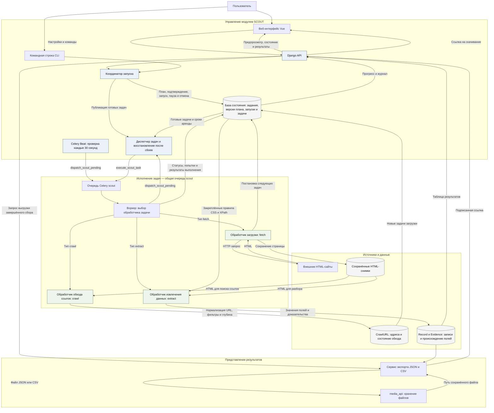

# SCOUT

Модуль собирает записи с HTML-страницы. Пользователь задаёт адрес, при необходимости селектор карточки и правила CSS или XPath, смотрит предпросмотр и подтверждает план. Только после этого основной сбор пишет записи и даёт скачать JSON или CSV.

После подтверждения плана можно собирать только указанные страницы или обходить ссылки в пределах сайта, глубины и лимита страниц. Поиск сайтов по теме, клики по карточке и языковая модель в эту версию не входят. Одновременно выполняется один сбор. Первая версия рассчитана на Windows и Linux.

Клиент ведёт по шести этапам: режим → источник и правила → предпросмотр → подтверждение → сбор → результат. Реализован ручной режим; визуальный и ИИ-режимы обозначены как недоступные до расширения API. Форма и таблица адаптируются к узким экранам, светлой, тёмной и автоматической темам ERGOMS. «Настройки системы» открывают настройки ядра; правила сбора редактируются в задании. Проверки и границы реализации описаны в [статусе клиента](docs/IMPLEMENTATION_STATUS.md#новый-клиент-ручного-сбора).

## Архитектура текущей версии

Все задачи идут через общую очередь `scout`. `fetch`, `crawl` и `extract` — обработчики типов задач внутри Python-воркера. Диспетчер публикует готовые задачи, а Celery Beat каждые 30 секунд ставит в ту же очередь задачу сверки и восстановления просроченных аренд.



База состояния, `CrawlURL`, `Record` и `Evidence` на схеме показаны отдельными логическими блоками, но хранятся в одной БД модуля. HTML-снимки лежат в `virtual_env/cache/scout/snapshots/`, файлы выгрузки — в `media_api`. Основной сбор запускается только после подтверждения хеша версии плана; предварительная загрузка страницы нужна для предпросмотра до подтверждения.

План развития описан в [PARSER_ARCHITECTURE.md](docs/PARSER_ARCHITECTURE.md), реализованные возможности — в [IMPLEMENTATION_STATUS.md](docs/IMPLEMENTATION_STATUS.md), результаты проверок — в [PHASE_2A_REPORT.md](docs/PHASE_2A_REPORT.md).

## Проектирование и дальнейшая работа

Сейчас уточняются UX и структура Scout; дополнительные машины оставлены на будущее.

- [AGENTS.md](AGENTS.md) — инструкции; [BACKLOG.md](BACKLOG.md) — задачи и ответственные.
- [FRONTEND](docs/teams/FRONTEND.md) и [SYSTEM](docs/teams/SYSTEM.md) — с чего начать каждой команде.
- [Карта документации](docs/README.md) — решения, UX, дизайн, API и текущее состояние.

## Зависимости

Обязательных модулей нет. Очередь — Celery платформы, файлы выгрузки — media_api, пользователи и меню — ядро.

Для живого сбора должны быть запущены база, брокер очереди и воркер:

```text
ergoms start-worker --module=scout
```

Для переиспользования соединений PostgreSQL задайте `SCOUT_WORKER_DB_REUSE_MAX=50` в `modules/scout/.env` и перезапустите отдельный воркер. `0` или отсутствие переменной оставляет штатное закрытие соединений после каждой задачи. Настройку считывает только воркер, запущенный с `--module=scout`.

Закрытие Cursor воркер не останавливает. `ergoms stop` останавливает службы проекта.

## Команды

```text
ergoms scout:collect --url https://example.com --field title=css:h1 --user-public-id <uuid>
ergoms scout:approve-run --run <uuid> --user-public-id <uuid>
ergoms api test modules.scout.api
```

GitHub Actions проверяет миграции и запускает тесты Scout с PostgreSQL на каждом pull request и при обновлении `dev`. Результат виден во вкладке **Checks** под именем **Scout tests / Django + PostgreSQL**.

Повторяющееся поле в команде отмечается звёздочкой: `title*=css:.card .title`.

Переменная `SCOUT_TASK_RUNNER=inline` в `modules/scout/.env.example` выполняет задачи в том же процессе. Для обычной работы оставьте `celery`.

Для приёмки UX-001 можно поднять [проверочный каталог](api/tests/fixtures/visual_catalog.html) на локальном стенде. В каталоге три карточки с одним, нулём и двумя совпадениями для `.price`. Укажите `SCOUT_TRUSTED_FETCH_ENDPOINTS=127.0.0.1:8765` в `modules/scout/.env` стенда и запустите Django и воркер с этой настройкой. Из корня ERGOMS выполните команду ниже, затем откройте `http://127.0.0.1:8765/visual_catalog.html` через визуальный редактор Scout.

```text
python -m http.server 8765 --bind 127.0.0.1 --directory modules/scout/api/tests/fixtures
```

## Куда смотреть

| Что | Где |
|---|---|
| План и подтверждение | `api/services/runs.py` |
| Загрузка и извлечение | `api/services/tasks_exec.py` |
| Страница | `client/components/ScoutPage.vue` |
| Как должен работать модуль | `BEHAVIOR.md` |
| Что уже сделано | `docs/IMPLEMENTATION_STATUS.md` |
